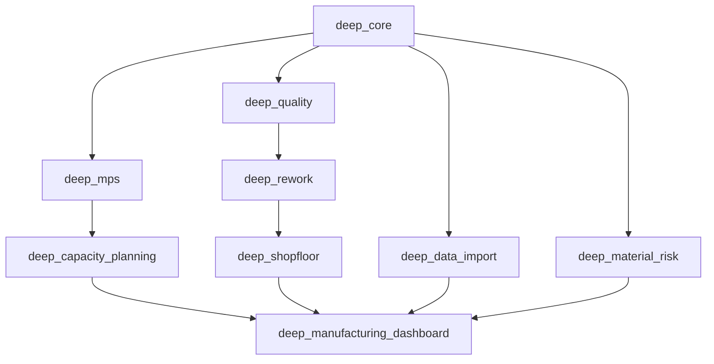
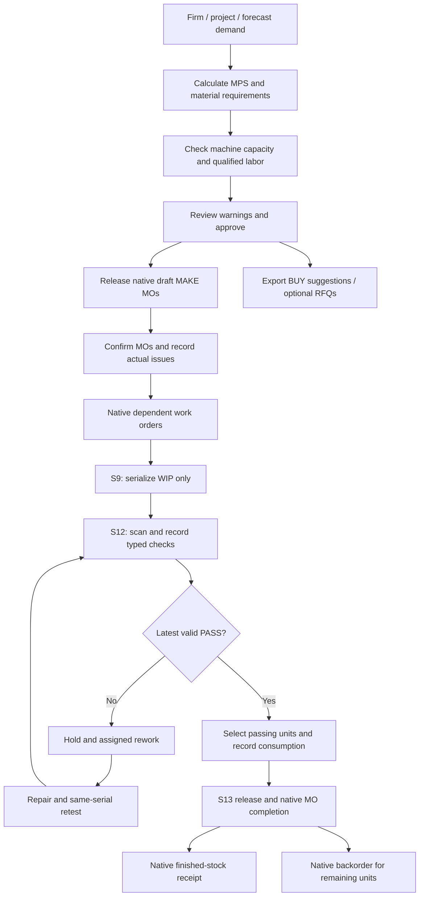

# Architecture

## Native transactional core

Odoo 19 Community owns products, units of measure, BOMs, operations, work centers/calendars, MOs, work orders, reservations, stock moves/lots/quants, receipts, transfers, purchase orders, users and employees. Custom modules add planning/QA/rework records and validated workflow gates. No Odoo core source is changed. `runtime/` only configures and starts the official CLI.

Python models declare persistence and public actions. `services/` implement orchestration/calculation. `wizard/` holds user-entered actual quantities. XML declares menus/forms/reports/security. OWL components use the native `orm`, `action` and notification services; they contain no stock accounting or release authority. Import handlers are split into master-data, BOM/routing and transaction modules. Pure math/evaluation modules work without Odoo and have standalone tests.

## Demand and manufacturing flow

Serial generation creates a native lot and immutable WIP identity, never a finished-stock receipt. `physical_zone` is a logical WIP control location with audit history: an unfinished identity is not a fake finished-product quant. Actual issue, repair replacement-part and final production movements use native stock moves. Native MO inventory posting, completion state changes and finished stock move completion are all gated, including calls outside the OWL UI.

## Planning rules

Firm and project demand consume forecast within each product/bucket. Default nominal demand is `max(firm + project, forecast) + manual`; confidence-weighted demand is reported separately. The additive strategy deliberately adds all categories. Beginning stock uses native free stock plus incoming supply before the horizon. Receipts inside each bucket reduce planned production. A shared material allocation ledger consumes stock and dated receipts once across recursive requirements; units of measure, phantom BOMs, scrap, lead times and cycles are handled.

MAKE requirements create real draft MOs with nearest MAKE parent links; BUY requirements remain suggestions in SAP mode. Release is idempotent. Released source demand cannot be reused by another plan. Reviewed/approved/firm/released inputs and their captured demand are frozen; revise by creating a new plan. Changing draft inputs invalidates calculation so review requires recalculation. Explicit multilevel release requires make-to-stock routing to prevent duplicate native MTO explosions.

Capacity is rough-cut planning, not automatic finite scheduling. It compares calendar hours and time off with native work-order load plus proposed plan load, setup/cleanup, batches, cycle time and efficiency. Labor uses allocated shift hours and required skill/rank/expiry. Scheduled loads belong to their start bucket; long work orders are not automatically split across periods. The timeline edits unstarted native work orders through a reasoned, audited action.

## Consistency and security

Each RPC runs in a native database transaction. Serial, release, scan, rework and import workflows lock involved records using ordered `FOR UPDATE`; database uniqueness constraints protect serials, request keys and history identities. Private service capabilities are Python objects, so an RPC context boolean cannot unlock immutable records. Calls still validate role, record access, company, state, station, quantity and tester/technician ownership.

Global company rules apply to custom persistent models. Planner, operator, warehouse, QA, technician, supervisor, procurement and manager roles are defined centrally. Native BOM/operation modifications are restricted in Python as well as UI. Permanent audit/scan/result/rework records cannot be deleted through normal actions. Technicians see only assigned repair work unless another authorized role provides broader access.

The default HTTP listener is localhost, PostgreSQL is internal to Compose, secrets live in generated `.env`/private runtime configuration, and database plus filestore backups pause application writes. A production reverse proxy, TLS, monitoring, email delivery and organizational access provisioning belong to the deployment environment.
