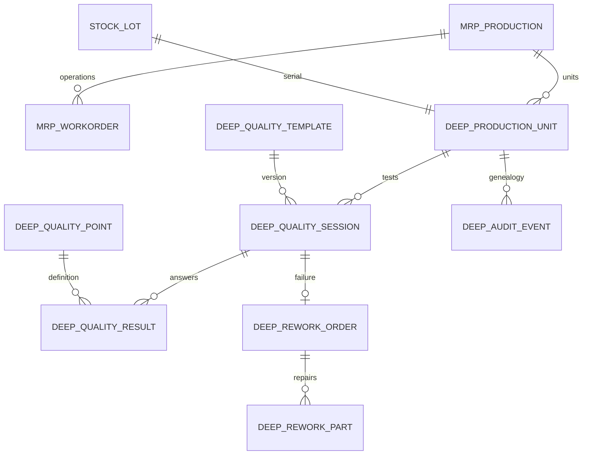

# Database and model structure

Use Odoo ORM for application data. SQL is limited to transactional record locks, constraints/indexes and the read-only analytic quality view; there is no parallel inventory ledger.

| Domain | Native models | Custom models |
|---|---|---|
| Product structure | product.template/product, mrp.bom/line, mrp.routing.workcenter | deep.product.family; native `deep_*` fields |
| Manufacturing | mrp.production/workorder, stock.move/move.line | deep.production.batch, deep.production.unit, deep.serial.request |
| Planning | stock.quant/move, native supplierinfo | deep.demand, deep.mps.plan/period/line, deep.material.requirement |
| Capacity | mrp.workcenter/capacity, resource.calendar, hr.employee | deep.skill/level, deep.employee.skill, deep.operation.skill, deep.labor.shift, deep.capacity.snapshot |
| Quality | stock.lot, ir.attachment | deep.quality.template/point/session/result, deep.scan.event |
| Rework | native part stock moves | deep.rework.order/part |
| Imports | native master/transaction records | deep.import.batch |
| Reporting | native MO/work-order state | deep.material.risk, deep.quality.summary SQL view, deep.audit.event |

## Guarantees

- Native Odoo lot identity plus unique `(company_id, unit.name)` and `unit.lot_id`.
- One serial-request key per MO, one scan key per company/tester, one session per scan, one typed answer per session/point, one repair order per failed session.
- Plan periods and product/bucket lines have unique identities; service-owned results cannot be directly edited.
- Native company checks plus global company rules on custom records.
- Positive demand, bounded confidence/scrap/yield, positive operator counts and valid date/time intervals are database or ORM constraints.
- Used quality template versions and typed results are immutable. Retests append sessions on the same lot/unit.
- Historical QA indexes cover unit history and company/outcome/time. `deep_quality/migrations/19.0.1.0.1/post-migrate.py` installs the same indexes during upgrades; clean installation creates them in `init()`.
- `deep.quality.summary` derives tested, first-pass, last-pass, retest and retest-pass flags from immutable session history. Native ORM searches/grouping handle access rules for the reporting models.

## Deployment data ownership

`postgres-data` contains all database tables. `odoo-data` contains the Odoo filestore and runtime files. Back up both together. The source ZIP contains no database, credentials, filestore or upstream Odoo copy. Regenerate demo data on initial pilot installation; do not confuse screenshot lab records with imported real inventory.

For upgrades, back up first, deploy the new source, run native module updates with application writes paused, then authenticate and run acceptance in a pilot database. Migration scripts never fabricate historical QA passes or reconcile stock with SQL.
